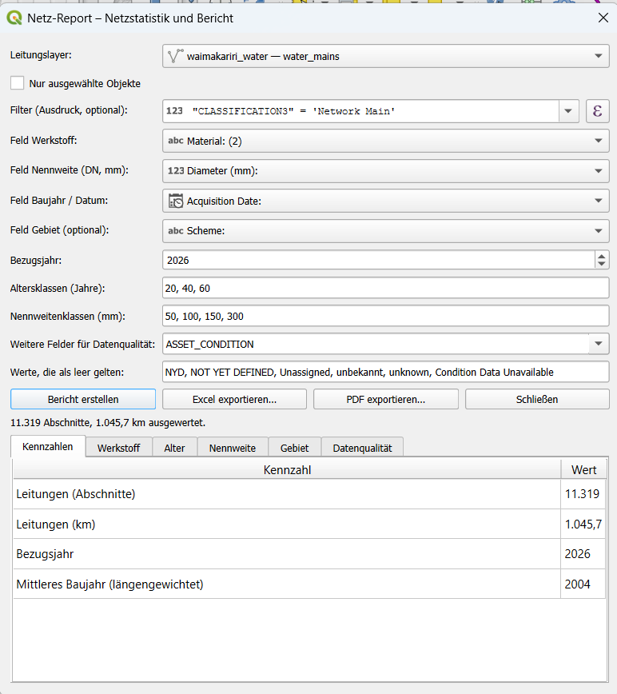
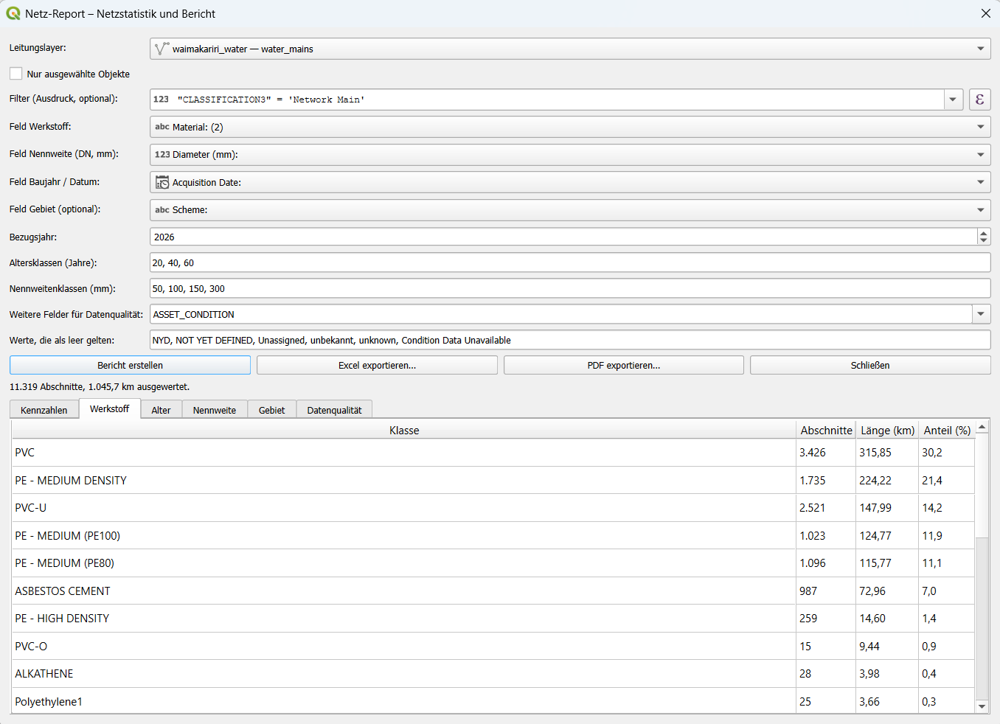
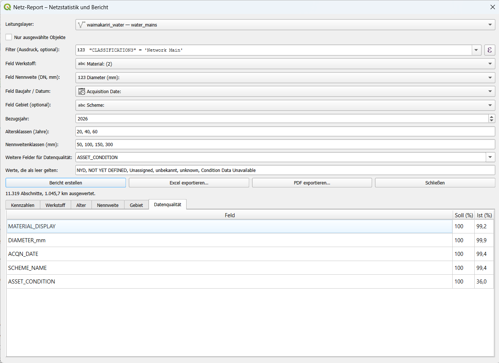
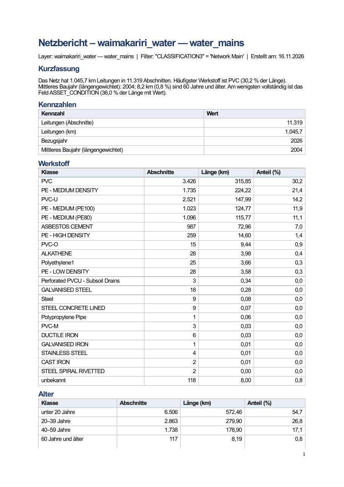

# QGIS Netz-Report – Network Statistics and Report for Utility Networks

[English](#qgis-netz-report--network-statistics-and-report-for-utility-networks) | [Deutsch](#deutsch)

**Netz-Report** is a QGIS plugin (Python / PyQGIS) that evaluates line layers of utility networks – water and gas pipes, power cables, fibre – with one click: length and share by **material**, **diameter class**, **age class** and **area**, plus the **data completeness** of selected fields (target/actual). The results are shown in tables and can be exported to **Excel** and as a **PDF report** with summary, key figures and data quality.



---

## Evaluations

| Table | What it shows |
|---|---|
| **Key figures** | Number of sections, total length in km, reference year, length-weighted mean installation year |
| **Material** | Sections, length (km) and share (%) per material |
| **Age** | Length per age class (default: under 20, 20–39, 40–59, 60 years and older) – from a year or date field |
| **Diameter** | Length per diameter class (default: up to DN 50, 51–100, 101–150, 151–300, over DN 300) |
| **Area** (optional) | Length per area, e.g. supply zone, district or scheme |
| **Data quality** | Share of the network length with a valid value for each field (target 100 %) – also for any other fields, e.g. condition |

**Filter and selection:** only selected features or a filter expression (e.g. only water mains, without service lines) can be evaluated.

**Classes and empty values:** age and diameter classes can be changed freely. Values such as *unknown*, *NOT YET DEFINED* or *Unassigned* can be counted as empty.

**Settings and language:** all fields, classes and the filter are remembered. The interface is shown in German when QGIS runs in German, otherwise in English.

**Export:** **Excel** (.xlsx, one sheet per table, real numbers for further calculations) and **PDF report** (summary, key figures, all tables, data quality).

## Test result

The plugin was tested with the public water network of the **Waimakariri District, New Zealand** (ArcGIS REST service of the district council, EPSG:2193), filtered to the water mains (`"CLASSIFICATION3" = 'Network Main'`). The results are **identical** to the separate Python analysis in the project [Water-Network-Analysis-Waimakariri](https://github.com/KonstantinosChantzis/Water-Network-Analysis-Waimakariri):

| Key figure | Result |
|---|---|
| Sections | 11,319 |
| Length | 1,045.7 km |
| Mean installation year (length-weighted) | 2004 |
| Most frequent material | PVC (30.2 % of the length) |
| Asbestos cement | 72.96 km (7.0 %) |
| Data completeness material / diameter / year | 99.2 % / 99.9 % / 99.4 % |
| Data completeness condition | 36.0 % |





**Export test:** the results were exported to Excel and as a 2-page PDF report.



The raw data of the district are not included in this repository. For a first try, the repository contains a small test network (`testdata/netz_testdaten.gpkg`, 13 pipes in Essen, EPSG:25832, fields *material*, *durchmesser*, *baujahr*): result 13 sections, 2.14 km, PE 50.5 %, data completeness material 86.0 % and diameter 87.9 %.

---

## Installation

1. Download this repository as ZIP (**Code → Download ZIP**) and unpack it
2. Zip only the folder `netz_report` (so that the ZIP contains `netz_report/…`)
3. QGIS → **Plugins → Manage and Install Plugins → Install from ZIP** → select the ZIP
4. A Netz-Report icon appears in the toolbar and under **Vector → Netz-Report**

Requirements: QGIS 3.28 or newer (prepared for QGIS 4 / Qt6).

## Usage

1. Load a network layer (or `testdata/netz_testdaten.gpkg`)
2. Open Netz-Report and choose the layer
3. Optional: enter a filter expression or tick *only selected features*
4. Choose the fields for material, diameter, year/date and area
5. Optional: change the age and diameter classes, choose further fields for the data quality and the values that count as empty
6. Click **Bericht erstellen** (create report) and look at the tabs
7. Click **Excel exportieren…** or **PDF exportieren…**

---

## Technical details

- **PyQGIS**: reads features with QgsFeatureRequest and filter expressions; length from the geometry in the layer CRS
- **Statistics**: own Python module (`core.py`) without extra libraries – classes, shares, length-weighted mean year, data completeness by length
- **Year detection**: works with year numbers, dates and date/time fields
- **User interface**: Qt dialog written in Python (QgsMapLayerComboBox, QgsFieldComboBox, QgsFieldExpressionWidget, QgsCheckableComboBox, QTableWidget with tabs)
- **Excel export**: GDAL/OGR XLSX driver, one sheet per table, numeric fields
- **PDF export**: HTML report rendered with QTextDocument and QPrinter (A4, table headers repeat on new pages)
- **Settings**: QgsSettings; **translation**: German/English depending on the QGIS locale
- Compatible with QGIS 3.x and 4.x

## Roadmap

- Processing algorithm so the report can be used in models and batch runs
- Charts (bar charts per material and age class) in the PDF report
- Publication in the official QGIS Plugin Repository

---

## Repository structure

```
QGIS-Netz-Report/
├── netz_report/
│   ├── __init__.py      # plugin entry point
│   ├── netz_report.py   # main class: menu, toolbar, workflow, Excel and PDF export
│   ├── core.py          # statistics functions
│   ├── dialog.py        # user interface
│   ├── i18n.py          # German / English texts
│   ├── metadata.txt     # plugin metadata
│   ├── icon.png
│   └── LICENSE
├── testdata/
│   └── netz_testdaten.gpkg   # 13 pipes
├── images/
│   ├── 01_netz_report_kennzahlen.png
│   ├── 02_werkstoff.png
│   ├── 03_datenqualitaet.png
│   └── 04_pdf_bericht.png
├── LICENSE
└── README.md
```

## Tools

QGIS 3.44 · Python · PyQGIS · Qt (PyQt) · GDAL/OGR · GeoPackage

## License

MIT License – see [LICENSE](LICENSE)

---
---

# Deutsch

[English](#qgis-netz-report--network-statistics-and-report-for-utility-networks) | [Deutsch](#deutsch)

**Netz-Report** ist ein QGIS-Plugin (Python / PyQGIS), das Leitungslayer von Versorgungsnetzen – Wasser- und Gasleitungen, Stromkabel, Glasfaser – mit einem Klick auswertet: Länge und Anteil nach **Werkstoff**, **Nennweitenklasse**, **Altersklasse** und **Gebiet** sowie die **Vollständigkeit der Sachdaten** ausgewählter Felder (Soll–Ist). Die Ergebnisse werden in Tabellen angezeigt und können nach **Excel** und als **PDF-Bericht** mit Kurzfassung, Kennzahlen und Datenqualität exportiert werden.


---

## Auswertungen

| Tabelle | Was gezeigt wird |
|---|---|
| **Kennzahlen** | Anzahl Abschnitte, Gesamtlänge in km, Bezugsjahr, längengewichtetes mittleres Baujahr |
| **Werkstoff** | Abschnitte, Länge (km) und Anteil (%) je Werkstoff |
| **Alter** | Länge je Altersklasse (Standard: unter 20, 20–39, 40–59, 60 Jahre und älter) – aus einem Jahres- oder Datumsfeld |
| **Nennweite** | Länge je Nennweitenklasse (Standard: bis DN 50, 51–100, 101–150, 151–300, über DN 300) |
| **Gebiet** (optional) | Länge je Gebiet, z. B. Versorgungszone, Ortsteil oder Netzgebiet |
| **Datenqualität** | Anteil der Netzlänge mit gültigem Wert je Feld (Soll 100 %) – auch für weitere Felder, z. B. Zustand |

**Filter und Auswahl:** Es können nur ausgewählte Objekte oder ein Filterausdruck ausgewertet werden (z. B. nur Hauptleitungen, ohne Hausanschlüsse).

**Klassen und leere Werte:** Alters- und Nennweitenklassen sind frei einstellbar. Werte wie *unbekannt*, *NOT YET DEFINED* oder *Unassigned* können als leer gezählt werden.

**Einstellungen und Sprache:** Alle Felder, Klassen und der Filter bleiben gespeichert. Die Oberfläche erscheint auf Deutsch, wenn QGIS auf Deutsch läuft, sonst auf Englisch.

**Export:** **Excel** (.xlsx, ein Tabellenblatt je Tabelle, echte Zahlen zum Weiterrechnen) und **PDF-Bericht** (Kurzfassung, Kennzahlen, alle Tabellen, Datenqualität).

## Testergebnis

Das Plugin wurde mit dem öffentlichen Wassernetz des **Waimakariri District, Neuseeland** getestet (ArcGIS-REST-Dienst der Bezirksverwaltung, EPSG:2193), gefiltert auf die Hauptleitungen (`"CLASSIFICATION3" = 'Network Main'`). Die Ergebnisse sind **identisch** mit der separaten Python-Analyse im Projekt [Water-Network-Analysis-Waimakariri](https://github.com/KonstantinosChantzis/Water-Network-Analysis-Waimakariri):

| Kennzahl | Ergebnis |
|---|---|
| Abschnitte | 11.319 |
| Länge | 1.045,7 km |
| Mittleres Baujahr (längengewichtet) | 2004 |
| Häufigster Werkstoff | PVC (30,2 % der Länge) |
| Asbestzement | 72,96 km (7,0 %) |
| Vollständigkeit Werkstoff / Nennweite / Baujahr | 99,2 % / 99,9 % / 99,4 % |
| Vollständigkeit Zustand | 36,0 % |


**Exporttest:** Die Ergebnisse wurden nach Excel und als 2-seitiger PDF-Bericht exportiert.


Die Rohdaten des Bezirks sind nicht im Repository enthalten. Zum Ausprobieren enthält das Repository ein kleines Testnetz (`testdata/netz_testdaten.gpkg`, 13 Leitungen in Essen, EPSG:25832, Felder *material*, *durchmesser*, *baujahr*): Ergebnis 13 Abschnitte, 2,14 km, PE 50,5 %, Vollständigkeit Material 86,0 % und Durchmesser 87,9 %.

---

## Installation

1. Repository als ZIP herunterladen (**Code → Download ZIP**) und entpacken
2. Nur den Ordner `netz_report` zippen (die ZIP-Datei muss `netz_report/…` enthalten)
3. QGIS → **Erweiterungen → Erweiterungen verwalten und installieren → Aus ZIP installieren** → ZIP auswählen
4. In der Werkzeugleiste erscheint ein Netz-Report-Symbol, außerdem unter **Vektor → Netz-Report**

Voraussetzung: QGIS 3.28 oder neuer (vorbereitet für QGIS 4 / Qt6).

## Bedienung

1. Netzlayer laden (oder `testdata/netz_testdaten.gpkg`)
2. Netz-Report öffnen und den Layer wählen
3. Optional: Filterausdruck eingeben oder *Nur ausgewählte Objekte* anhaken
4. Felder für Werkstoff, Nennweite, Baujahr/Datum und Gebiet wählen
5. Optional: Alters- und Nennweitenklassen ändern, weitere Felder für die Datenqualität und die als leer geltenden Werte wählen
6. **Bericht erstellen** klicken und die Tabs ansehen
7. **Excel exportieren…** oder **PDF exportieren…** klicken

---

## Technische Details

- **PyQGIS**: Lesen der Objekte mit QgsFeatureRequest und Filterausdrücken; Länge aus der Geometrie im Layer-KBS
- **Statistik**: eigenes Python-Modul (`core.py`) ohne Zusatzbibliotheken – Klassen, Anteile, längengewichtetes mittleres Baujahr, Vollständigkeit nach Länge
- **Baujahr**: funktioniert mit Jahreszahlen, Datums- und Datum/Zeit-Feldern
- **Benutzeroberfläche**: Qt-Dialog in Python (QgsMapLayerComboBox, QgsFieldComboBox, QgsFieldExpressionWidget, QgsCheckableComboBox, QTableWidget mit Tabs)
- **Excel-Export**: XLSX-Treiber von GDAL/OGR, ein Tabellenblatt je Tabelle, numerische Felder
- **PDF-Export**: HTML-Bericht über QTextDocument und QPrinter (A4, Tabellenköpfe wiederholen sich auf neuen Seiten)
- **Einstellungen**: QgsSettings; **Übersetzung**: Deutsch/Englisch je nach QGIS-Sprache
- Kompatibel mit QGIS 3.x und 4.x

## Weiterentwicklung

- Processing-Algorithmus für Modelle und Stapelverarbeitung
- Diagramme (Balken je Werkstoff und Altersklasse) im PDF-Bericht
- Veröffentlichung im offiziellen QGIS-Plugin-Repository

---

## Werkzeuge

QGIS 3.44 · Python · PyQGIS · Qt (PyQt) · GDAL/OGR · GeoPackage

## Lizenz

MIT-Lizenz – siehe [LICENSE](LICENSE)
